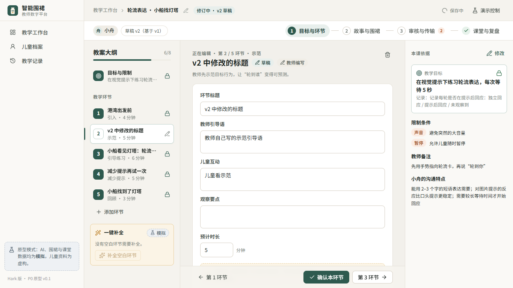
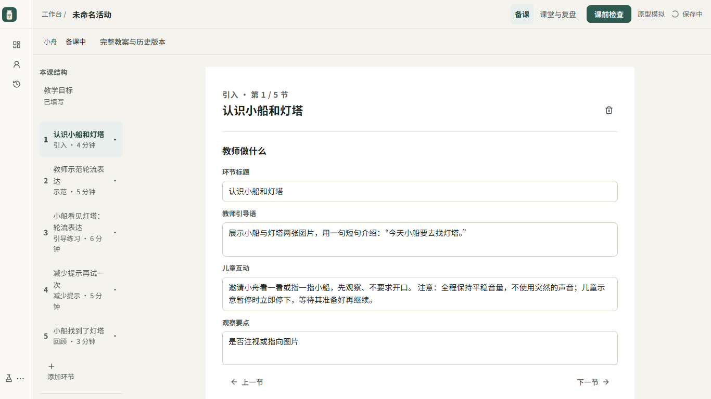
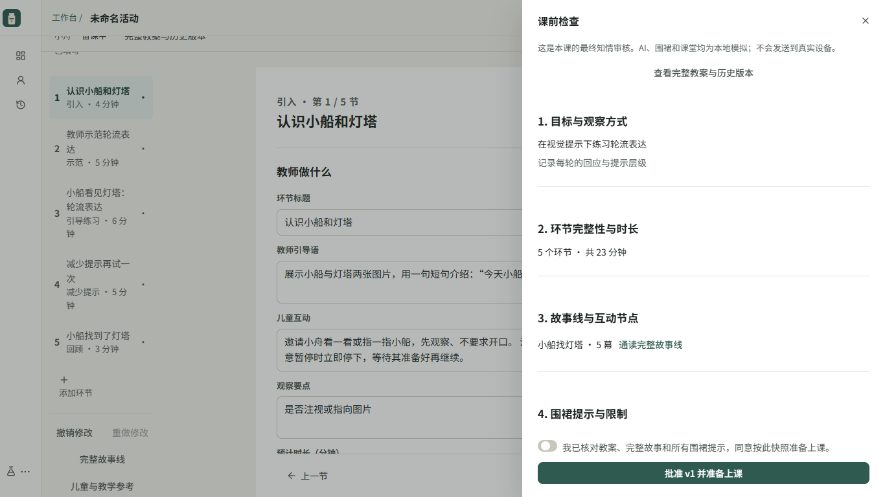

# Hark 版 UX 受控重构｜实施与验收报告

日期：2026-10-28。实施依据：用户提供的《智能围裙教师数字平台｜产品体验与 UI/UX 优化规划》，采用已确认方案 B；教师控制、业务正确性、历史兼容性优先于点击数目标。

## 交付与分支

- 基线：PR #1，`hark/independent-v01`，`24b5b8d7d2cc9348db50c9e301e1c1364bd4c454`。
- 独立工作分支：`codex/hark-ux-refactor`。PR 的 base 设为 Hark 分支，方便只审查本轮重构；不合并 main，不更新 PR #1。
- 可运行网页：`Hark/` 下 `npm ci`、`npm run dev -- --host 127.0.0.1`，打开 http://127.0.0.1:5184/ 。
- 实施记录：Phase 0 `23ccaf5`；Phase 1 `6619981`；统一编辑/集中批准 `b2f4bc9`；课后收口与无障碍 `f468724`；后续恢复、撤销、验收与文档见本分支最新提交。
- 所有改动限定 `Hark/`。原主目录的未提交修改未纳入本分支。

## 完成的产品变化

1. 四阶段变为「备课 / 课堂与复盘」。旧 `/story`、`/review` 会重定向；场景 `?focus=scene-…` 定位到其 `stepId`，旧 `?version=…` 打开原批准快照。
2. 一次只编辑一个教学环节。同一主稿中关联教师引导、儿童互动、观察点、旁白、互动节点和围裙提示；完整故事梗概/角色/五幕连续叙事仍可通读。
3. 删除逐节确认与独立故事/围裙确认入口。目标/限制变化时显示受影响内容集中核对，过期候选和限制冲突依然阻断。
4. 整课候选先预览，既有教师内容保持；可取消个别候选、采纳所选。单节改写提供字段原文/新文，教师决定是否替换。刷新仍保留未处理候选及其过期状态。
5. 围裙按限制生成安全建议；被限制排除的条目与原因可见。已有配置不自动覆盖，替换时显示当前/建议。课前检查逐场景列出实际视觉/声音、自动/教师触发和暂停配置。
6. 一次课前知情审核，内部顺序仍为批准 → 不可变快照 → 保存成功 → 连接/模拟传输 → 保存回执。失败后沿用同一版本安全重试。
7. 一次结束模拟课堂并生成复盘，来源默认分类；一次具体归档预览后先审核、再幂等写入。保留「仅完成复盘」。
8. 编辑撤销/重做覆盖文本与环节增删，最近 40 步、仅当前页面内存；不跨批准/继续修订边界。恢复不复活旧候选，目标/限制恢复仍需复核。

## 关键界面对比

可打开 [可视对照页](ux/comparison.html)，原版/新版截图均来自本机浏览器真实运行。

| 项目 | 原版实测 | 新版实测 |
|---|---|---|
| 工作模式 | 4 阶段 | 2 模式 |
| 1366px 活动顶部栏+阶段条 | 108px | 56px；另有内容元信息行，不计入顶栏 |
| 1366px 编辑正文 | 534px | 760px |
| 固定参考栏 | 常驻、挤压正文 | 覆盖式抽屉，打开前后正文等宽 |
| 实际可见最小字号 | 11px | 13px |
| 故事维护 | 独立阶段 | 同环节编辑 + 完整叙事预览 |
| 手机环节导航 | 大纲/正文切换 | 默认收起的环节选择器 |

原版宽度来自 `before/metrics.json` 的 `.editor-inner`，新版为 `.lesson-paper` 扣除 padding 的内容宽度。它们均代表输入区域可用宽度；不是把纸面外宽度当正文。

备课原版：

备课新版：

课前检查：

## 教师操作链路

| 任务 | 原版 | 新版 |
|---|---|---|
| 课前 | 目标确认 → 环节逐个确认 → 故事阶段 → 围裙确认 → 审核/批准弹窗 → 连接 → 传输 | 生成/审阅整课候选 → 同一主稿编辑 → 一次课前审核与准备上课 |
| 修改目标 | 解除确认 → 改目标 → 5 个环节逐个复核 → 故事复核 | 直接编辑 → 集中查看原/当前目标与受影响内容 → 一次确认仍适用 |
| 课后 | 建课堂 → 生成复盘 → 审核 → 写档案 → 再确认 | 结束模拟课堂并生成复盘 → 核对总结/观察 → 单次写入预览与确认 |
| 返回修订 | 继续修订后逐项解锁 | 继续修订即进入可编辑稿，历史版本不变 |

本轮无报错默认五环节路径，从空工作台到准备上课，排除实际文字输入/可选阅读滚动，共 **6 次控件激活**：新建、生成、采纳、打开检查、勾选知情审核、批准并准备上课。其中需承担内容责任的是采纳与最终审核两个决策节点。课后仍有独立归档决定。此计数来自自动化走查步骤，不代表真实教师速度或教学有效性。报告中的原版 22–26 次为静态估算，本轮不把它当成实测计时。

## 业务兼容与测试

| 检查 | 实际结果与边界 |
|---|---|
| 原版基线 | 16/16 单测、build、69/69 原版 E2E 通过 |
| 新版领域回归 | 57/57 通过，包括原 16 项完全保留 |
| 新版 build | TypeScript + Vite 生产构建通过 |
| 新版 E2E | 58 项明确断言通过；独立服务器 5194，不复用其他目录服务 |
| axe | 1366/390 两种宽度，工作台/备课/课堂/记录/档案/课前检查，12 样本，0 违规 |
| 视口 | 1440×900、1366×768、1024×768、390×844 备课/课堂均无页面级横向滚动 |
| 键盘 | Tab/Shift+Tab 焦点循环、Esc/归还焦点；纯键盘完成备课→检查→传输→复盘→档案 |
| 长文本/动效 | 四视口长文本无溢出；reduced-motion 生效；683×384 等效缩放布局无溢出 |
| 候选保护 | 源 revision 修改后不可应用；过期异步结果不写入；既有草稿不被整课补全覆盖 |
| 集中批准 | 未处理候选、待复核、缺内容/场景、声音/暂停/未知提示冲突均不可绕过 |
| 版本/持久化 | 保存失败不连接/传输；重试不增加批准版本；错误版本/校验回执被拒绝；回执保存重试不重复发送 |
| 旧数据 | 原版真实闭环产生的 schemaVersion=1 fixture 原样恢复；批准快照校验码/课堂引用不变 |
| 档案 | 未审核写入被领域拒绝；同一次课堂只能追加一次观察；归档预览可见儿童、文字与版本 |
| 撤销 | 文本撤销/重做、环节增删撤销实测；修订号递增；不改变历史快照、不跨批准边界 |
| 错误状态 | AI/保存/传输失败与恢复；损坏 JSON 不自动覆盖 |

`checks.ts` 的 SHA256 仍为 `EE48E678A27BD8AAFAAD36E77EFF2B049DF705817B411B84F53152FC4E43C23F`，判定没有放宽。`reducer.ts` 只增加新 action，旧 action 实现不改；`types.ts` 仅在 `PlanDraft` 添加可选 `lessonCandidate`，不删除或重命名字段，不升级 schema。新版额外检查观察方式、有效时长、缺失场景、未知 cue 等；旧批准历史仍能读取，不重新评判/改写旧快照。

自动化入口：`npm test`、`npm run build`、`npm run e2e`。原始结构化结果：`ux/after/results.json`、`class-results.json`、`recovery-results.json`、`keyboard-results.json`、`undo-results.json`、`accessibility.json`、`metrics.json`。

## 工程判断与审查

- 使用报告方案 B 的任务、密度和异常优先方法；未重新启动产品规划。工作主要为顺序集成，主 Agent 单独实施和验收，没有创建额外聊天或并行修改者。
- 未采用任何“自动清空所有复核、直接放行”的建议。集体确认只迁移确认状态，不能豁免限制冲突，也没有无理由的安全豁免入口。
- 整课候选源校验采用整个草稿 revision，更保守：备注变化也会使候选过期，以避免旧上下文被误采纳。
- 原版阶段组件仍作为历史实现源码保留；活动路由只挂载新版工作区与检查抽屉，不存在旧/新版双操作入口。完整阅读、场景、角色、候选、传输和归档能力均迁移到新入口。
- 代码自审确认：diff 均在 `Hark/`；旧规则测试不改；新增只读/写入边界有回归；未新增生产依赖。测试开发依赖 `@axe-core/playwright` 已检查元数据并以 `--ignore-scripts` 安装，npm audit 0 vulnerabilities。

## 尚未解决与证据限制

- 未做真实教师可用性试验；需要教师实际完成任务，才能判断犹豫、阅读负担和教学适配。
- 仅在 Windows/Edge 实测。Safari、Firefox、真实浏览器 200% zoom、打印机输出未实测；等效布局检查不替代真实缩放。
- 当前只有一个虚构儿童；多儿童新建选择流程不在本次范围。
- 撤销栈只在当前页面内存中，不跨刷新保存；原 schema v1 不含完整历史目标文本，刷新后的差异对照可能只能使用已批准版本，界面会说明。
- AI、围裙、课堂全部仍是模拟，不声称已连接真实设备、完成真实儿童评估或证明教学有效性。
